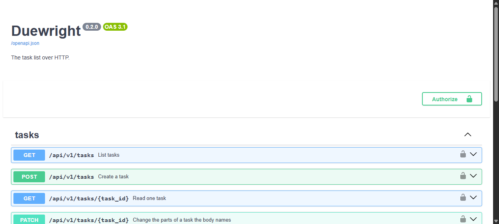

# Duewright


A task manager with a menu, a REST API and a database, in about a thousand lines of Python. One core holds the rules and both interfaces work through it, so a rule fixed once is fixed in both places.

Tasks carry a stable id, and an id is never handed to a second task, so a number you wrote down keeps pointing at the same task even after a deletion.

## See it working

The menu:

```
$ duewright

Duewright

1) Add a task
2) List tasks
3) Edit a task
4) Mark a task done / undone
5) Delete a task
6) Filter the list
7) Search titles
0) Quit

Choose an option: 1
Title: Pay the rent
Priority (low/medium/high, blank for medium): high
Due date (YYYY-MM-DD, blank for none): 2026-10-05
[ ]    1  Pay the rent              high    due 2026-10-05  OVERDUE
1 pending, 1 overdue, 0 done
Choose an option: 0
Goodbye.
```

The same tasks over HTTP:

```
$ curl -s -X POST localhost:8000/api/v1/tasks -H "X-API-Key: $DUEWRIGHT_API_KEY" \
       -H "Content-Type: application/json" \
       -d '{"title":"Pay the rent","priority":"high","due_date":"2026-10-05"}'
{"id":1,"title":"Pay the rent","done":false,"priority":"high","due_date":"2026-10-05","created_at":"2026-10-18T18:21:53+00:00"}

$ curl -s -X PATCH localhost:8000/api/v1/tasks/1 -H "X-API-Key: $DUEWRIGHT_API_KEY" \
       -H "Content-Type: application/json" -d '{"done":true}'
{"id":1,"title":"Pay the rent","done":true,"priority":"high","due_date":"2026-10-05","created_at":"2026-10-18T18:21:53+00:00"}

$ curl -s "localhost:8000/api/v1/tasks?done=false" -H "X-API-Key: $DUEWRIGHT_API_KEY"
{"items":[],"total":0,"limit":20,"offset":0}
```

The API documents itself, and every route can be tried from the page:



## Install it

Duewright needs Python 3.12 or newer.

```
pip install -e ".[dev,api]"
```

That gives you a `duewright` command that works from any folder, pytest, and the server. The extras are separate, so you can take only what you need: `dev` brings the tests, `api` brings the server.

```
duewright          # the menu
duewright serve    # the API
```

With Docker, no Python setup is needed at all:

```
export DUEWRIGHT_API_KEY=$(python -c "import secrets; print(secrets.token_urlsafe(32))")
docker build -t duewright .
docker run --name duewright -p 127.0.0.1:8000:8000 \
  -e DUEWRIGHT_API_KEY -v duewright-data:/data duewright
```

Inside the container the server binds to every address, because that is its own network. The published port is limited to `127.0.0.1`, so the port is not open to your network, and the image runs as a user that is not root. The tasks live in the `duewright-data` volume rather than in the container, so replacing the container leaves them alone:

```
docker stop duewright && docker rm duewright
docker run --name duewright -p 127.0.0.1:8000:8000 \
  -e DUEWRIGHT_API_KEY -v duewright-data:/data duewright
```

## Use the menu

```
1) Add a task
2) List tasks
3) Edit a task
4) Mark a task done / undone
5) Delete a task
6) Filter the list
7) Search titles
0) Quit
```

The list looks like this:

```
[ ]    1  Pay the rent              high    due 2026-10-05  OVERDUE
[ ]    2  Water the plants          medium  due 2026-10-18  DUE TODAY
[ ]    5  Call the plumber          low     due 2026-10-20  DUE SOON
[ ]    4  Call Sam                  high
[x]    3  Book tickets              low
4 pending, 1 overdue, 1 done
```

Pending tasks come first, then tasks that carry a due date, earliest due date first, then higher priority before lower, then lower id. A task is overdue when it is pending and its due date has passed. A task due today gets its own marker, because it is not late yet. A task due within the next three days is marked DUE SOON, so the warning arrives before the day rather than on it.

Editing offers the title, the priority and the due date in turn. A field left blank keeps what the task already has, and answering none to the due date clears it. That is the same rule the API applies to a field left out of a request.

## Use the API

```
duewright serve
```

That binds to `127.0.0.1:8000`. It is the loopback address rather than every address, so starting the server does not put your task list on the network. `--host` and `--port` change both. Open `http://127.0.0.1:8000/docs` to try every route by hand.

### The key

Every route that holds data needs a key, sent as the `X-API-Key` header. The server refuses to start without one rather than starting open:

```
export DUEWRIGHT_API_KEY=$(python -c "import secrets; print(secrets.token_urlsafe(32))")
duewright serve
```

The key has to be at least sixteen characters. `.env.example` shows where it goes, and `.env` is ignored, so a real key never reaches the repository. Nothing logs it and no response echoes it. The interactive docs offer an Authorize button, so `/docs` works with the key too.

A server that cannot find a usable key stops and says how to make one:

```
Cannot start: DUEWRIGHT_API_KEY is not set.
Generate a key with:
  python -c "import secrets; print(secrets.token_urlsafe(32))"
```

### The routes

All of them sit under `/api/v1`:

```
GET    /health          the server is up, without touching the store
GET    /tasks           list, with done, q, limit and offset
POST   /tasks           create, answers 201
GET    /tasks/{id}      read one
PATCH  /tasks/{id}      change the fields the body names
DELETE /tasks/{id}      delete, answers 204 with no body
```

Listing answers with an envelope, so a client always knows where it is:

```json
{
  "items": [
    {
      "id": 1,
      "title": "Pay the rent",
      "done": false,
      "priority": "high",
      "due_date": "2026-10-05",
      "created_at": "2026-10-18T18:21:53+00:00"
    }
  ],
  "total": 1,
  "limit": 20,
  "offset": 0
}
```

A partial update tells a field that was left out from one sent as null. Leaving `due_date` out keeps it, and sending `"due_date": null` clears it. A null title is refused, because a task without one makes no sense:

```
curl -X PATCH localhost:8000/api/v1/tasks/1 -H "Content-Type: application/json" \
     -H "X-API-Key: $DUEWRIGHT_API_KEY" -d '{"due_date": null}'
```

A missing task answers 404 with a body naming the task. A body or a query that makes no sense answers 422, and a misspelled field fails loudly instead of being ignored.

## Where the tasks live

A SQLite database called `tasks.db`, in a folder named `.duewright` inside your home folder. It lives there rather than beside the code, so reinstalling or upgrading the program cannot touch your tasks. Set `DUEWRIGHT_DATA_DIR` to keep it somewhere else, which is also how the tests stay away from real data.

Set `DUEWRIGHT_BACKEND=json` to keep the tasks in a `tasks.json` file instead. Both backends pass the same contract tests and the menu behaves identically, but only the database copes with two copies of the program running at once.

The database refuses bad data on its own: a title that is empty or longer than 100 characters, a priority that is not one of the three, and a done flag that is not 0 or 1 are all rejected by the table, so a bug in the code above cannot write them. It also records which version of the schema it holds, and refuses to open a database written by a newer version of the program.

The JSON file, when you use it, is plain JSON and looks like this:

```json
{
  "version": 2,
  "next_id": 2,
  "tasks": [
    {
      "id": 1,
      "title": "Pay the rent",
      "done": false,
      "created_at": "2026-10-18T18:20:11+00:00",
      "priority": "high",
      "due_date": "2026-10-05"
    }
  ]
}
```

Three details are worth knowing about it. Every write goes to a temporary file that is swapped into place in one step, so a crash part-way through cannot leave a half-written file. If the file cannot be read, Duewright keeps it under a name like `tasks.json.corrupt-20261018-182011` and starts with an empty list, because that file may be the only copy of your tasks. And a file written by a newer version is refused rather than opened, so an older program cannot quietly drop fields it does not understand.

## Moving a JSON file into the database

If your tasks are in a JSON file, one command moves them into the database:

```
duewright migrate-json ~/.duewright/tasks.json --dry-run
duewright migrate-json ~/.duewright/tasks.json
```

The dry run reads the file and checks it without writing anything. The real run moves the tasks, keeping their ids and their creation times, then reads both sides back and compares every field before it reports success. The file itself is left exactly as it was, so it stays a copy of your tasks.

It refuses to run when the database already holds tasks, because merging two lists is not what the command is for.

### Upgrading from 0.1.0

The 0.1.0 release kept its file beside the code, at the top of the folder you installed from, beside the `duewright` folder itself. It looked for it there rather than in your data folder, so this version, which reads the data folder, opens with an empty list. Nothing is lost: the file is exactly where it was, and nothing has written to it since.

Point the command at that file and the tasks move across:

```
duewright migrate-json /path/to/duewright/tasks.json --dry-run
duewright migrate-json /path/to/duewright/tasks.json
```

The file is read with the same loader the program uses, so both versions the project has written are understood, and the tasks keep their ids, their priorities, their due dates and their creation times.

## How it is built

```
                    duewright                     duewright serve
                       menu                            API
                        |                              |
                        +--------------+---------------+
                                       |
                                   TaskService            the rules: order, overdue,
                                       |                  filter, search, summary
                                       |
                              TaskRepository              the interface every store
                                       |                  has to satisfy
                +----------------------+----------------------+
                |                      |                      |
        JsonTaskRepository   SqliteTaskRepository   InMemoryTaskRepository
             a file             the database              for tests
```

Four rules keep those apart, and they are the main lesson of the project:

1. Only `cli.py` calls `input()` or `print()`.
2. The service never touches the disk. It asks a repository, and only the repository modules know about files, JSON and SQL.
3. `validators.py` holds pure functions, so each rule is a short test.
4. The menu and the API both work through the same service, so a rule added for one is enforced in the other.

## Design decisions

### A repository interface, with one contract suite for every implementation

The rules do not know where the tasks are kept. They ask a repository, and three implementations satisfy the same interface: a JSON file, SQLite, and an in-memory store for tests. One contract suite runs the same behaviours against all three, so adding the database needed one word in a fixture and no change to the rules at all.

### SQLite, because two copies of the program can run at once

This is measured rather than asserted. `scripts/concurrency_demo.py` starts four processes that each add fifty tasks, then counts every task as stored, as one a worker failed to add, or as one another process overwrote:

```
$ python scripts/concurrency_demo.py --backend sqlite
tasks the workers were asked to add: 200
tasks the workers reported adding: 200
tasks in the store afterwards: 200
tasks a worker failed to add: 0
tasks overwritten by another process: 0
Nothing was lost.

$ python scripts/concurrency_demo.py --backend json     # on Linux
tasks the workers were asked to add: 200
tasks the workers reported adding: 2
tasks in the store afterwards: 0
tasks a worker failed to add: 198
tasks overwritten by another process: 2
worker 0 failed: CorruptStorageError: it is not valid JSON (Extra data: line 14 column 2 (char 235))
worker 1 failed: FileNotFoundError: [Errno 2] No such file or directory: '/tmp/duewright-demo-9lasn8uu/tasks.json.tmp' -> '/tmp/duewright-demo-9lasn8uu/tasks.json'
worker 3 failed: FileNotFoundError: [Errno 2] No such file or directory: '/tmp/duewright-demo-9lasn8uu/tasks.json' -> '/tmp/duewright-demo-9lasn8uu/tasks.json.corrupt-20261018-172721'
Not everything arrived: this store lost work when two processes wrote at once.
```

The database stored all two hundred tasks, on Windows and on Linux. The file lost almost everything: on Windows one task of the two hundred survived and every process died with a permission error, and on Linux none survived, with two writers corrupting the file until the program moved it aside as unreadable. The exact numbers move from run to run, because this is a race. The database result has not moved.

### Writes that cannot leave a half-written file

The JSON store writes to a temporary file and renames it into place in one step, so a crash cannot leave a truncated file behind. It never overwrites a file it could not parse, because that file may be the only copy of the tasks: it moves it aside under a `.corrupt-` name and reports where it went. The database gets the same guarantee from its own transactions.

### A migration that checks its own work

`duewright migrate-json` reads the file with the same loader the program uses, so every older version of it is understood, and writes every task in a single transaction, keeping the ids and creation times. Then it reads both sides back and compares every field before reporting success. A run that cannot prove the tasks arrived reports a failure instead.

### Parameterized queries

Every value reaches SQLite as a bound parameter, never as text joined into a statement. A title that looks like SQL is stored as the title, which is what a task manager should do with it.

### A partial update that tells an omitted field from a null one

`PATCH` uses the fields the request actually sent, so a due date can be cleared with `{"due_date": null}` while leaving it out keeps the date. A null title or priority is refused, because neither means anything, and a misspelled field is rejected rather than ignored.

### Plain functions for the routes

Every route that reaches the store is a plain `def` rather than an `async def`. The store blocks, and FastAPI runs a plain function in a worker thread, so a slow store delays one request instead of the whole server. A test walks every route under the versioned path and fails if any of them is a coroutine.

### A key that fails closed

The key is compared in constant time, so it cannot be guessed a character at a time. When no key is configured, every request is refused rather than allowed, which is the safer way to be wrong. The check lives on the router instead of on each route, so a route added later is protected without anyone having to remember.

### How I test

229 tests. Most run in process, and the ones that matter most run the real thing: the menu is driven as a process with the answers piped in, the server is started and called over HTTP, and the image is built and run. Coverage is measured across subprocesses too, because the menu's tests would otherwise look like untested code, and it stands at 87%.

Every test that carries a criterion was proved by breaking its assertion and watching the run go red first. That habit caught a walk over the API routes that passed on nothing when FastAPI changed how it keeps an included router, and a concurrency report that said "nothing was lost" for a run in which three of four workers had died.

Continuous integration runs the suite on Linux and Windows, on Python 3.12 and 3.13, and builds the Docker image on every push, checking the user it runs as, that nothing local was copied in, the health route, that the published port answers only on the loopback address, and that a task survives the container being replaced.

## Limitations

- One user, one static key. Anyone holding the key has the whole list. This is not a login system.
- No rate limiting, and no HTTPS. Put a reverse proxy in front before exposing it beyond your own machine, or the key travels in clear text.
- Ordering, paging and search happen in Python rather than in the store. That is right for a few hundred tasks and wrong for a hundred thousand.

## Layout

```
duewright/
├── duewright/
│   ├── __main__.py       # python -m duewright
│   ├── api/
│   │   ├── app.py        # the routes, and the one place errors are mapped
│   │   ├── deps.py       # what a route asks for, so a test can swap the store
│   │   ├── schemas.py    # the shape a request has and a response always has
│   │   └── security.py   # the key, as a dependency the router requires
│   ├── cli.py            # the menu and the commands, the only module that prints
│   ├── config.py         # where the tasks live, and which repository keeps them
│   ├── errors.py         # the errors the package raises
│   ├── models.py         # Task
│   ├── repositories/
│   │   ├── base.py       # the interface a repository has to satisfy
│   │   ├── json_repo.py  # the only module that knows about JSON
│   │   ├── memory.py     # for tests
│   │   ├── migrate.py    # moving a JSON file into the database
│   │   └── sqlite_repo.py # the database, and the only module that knows SQL
│   ├── security.py       # the rules about the key, which the command needs too
│   ├── service.py        # the rules: ordering, overdue, filter, search, summary
│   └── validators.py     # pure functions for the input
├── scripts/
│   └── concurrency_demo.py   # what several processes writing at once costs
├── tests/
│   ├── test_api.py           # the routes, in process, over an in-memory store
│   ├── test_cli.py           # the menu and the server, as real processes
│   ├── test_repositories.py  # the contract every repository has to satisfy
│   ├── test_json_repo.py     # the behaviours that belong to the file alone
│   ├── test_sqlite_repo.py   # the behaviours that belong to the database alone
│   ├── test_migrate.py       # moving the tasks over without losing any
│   └── ...
├── Dockerfile
├── pyproject.toml
├── CHANGELOG.md
├── GLOSSARY.md
└── docs/adr/             # the decisions, and why they were taken
```

## What I would improve

- Sorting and paging in the store instead of in Python.
- A fourth place to keep the tasks, such as PostgreSQL. The contract suite and the interface are in place, so a new backend is one class and no change to the rules.
